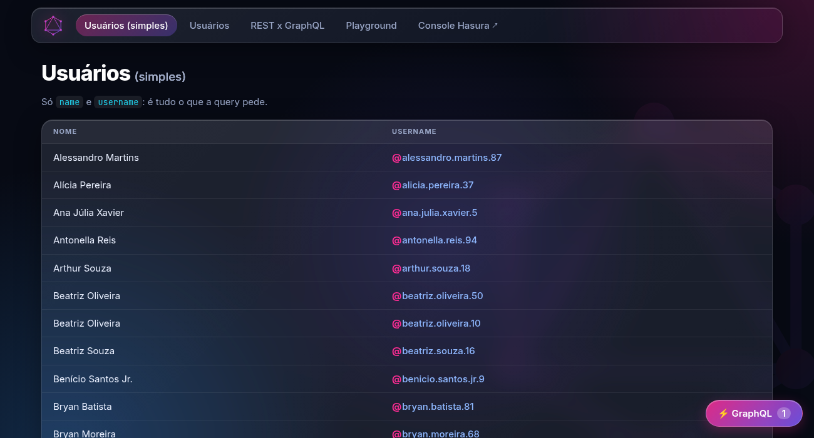
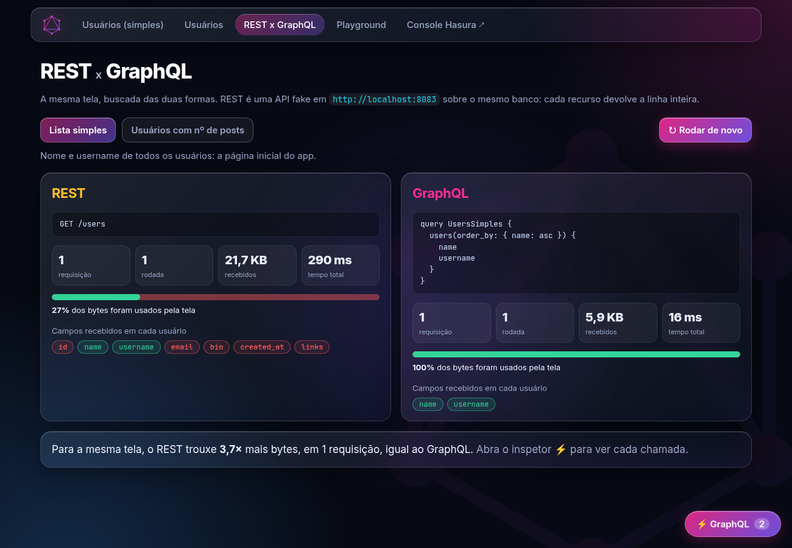
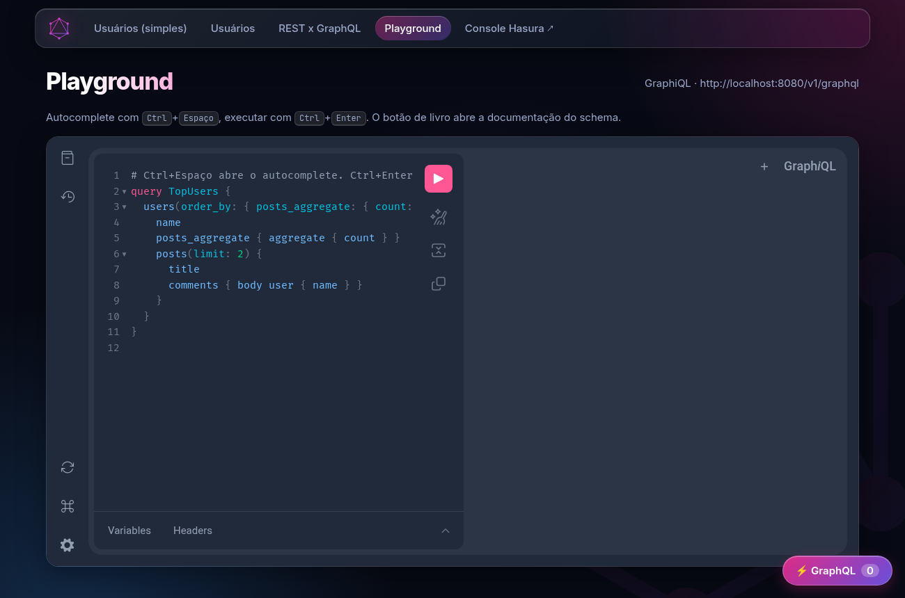

# graphqlab

Laboratório para aprender **GraphQL** na prática: Postgres + Hasura + Vue 3, tudo com Docker Compose, mais uma **API REST fake** para comparar as duas abordagens (overfetching e underfetching) com números reais.

| Início | REST x GraphQL | Playground (GraphiQL) |
|---|---|---|
|  |  |  |

## O que tem aqui

| Serviço | Porta | O que é |
|---|---|---|
| **Vue 3 + Vite** | [8081](http://localhost:8081) | App de exemplo com inspetor GraphQL lateral |
| **Hasura** | [8080](http://localhost:8080/console) | API GraphQL gerada a partir das tabelas do Postgres |
| **Postgres 17** | 8082 | Banco com `users`, `posts` e `comments` |
| **REST fake** | [8083](http://localhost:8083/users) | API REST tradicional sobre o mesmo banco |
| **Seeder** | n/a | Roda uma vez e cria 100 usuários, 0–5 posts cada e 0–3 comentários por post |

## Começando

Requisitos: Docker com Compose v2.

```bash
git clone <url-do-repositorio>
cd graphqlab
docker compose up -d --build
```

Abra **http://localhost:8081**. Na primeira subida o seeder popula o banco; as próximas não mexem nos dados.

## Credenciais

Tudo aqui é de **laboratório**, de propósito simples e público:

| Onde | Usuário | Senha |
|---|---|---|
| Console do Hasura (`localhost:8080/console`) | n/a | admin secret: `myadminsecretkey` |
| Postgres (`localhost:8082`, banco `graphqlab`) | `postgres` | `postgrespassword` |

O app Vue e o GraphiQL **não pedem senha**: as requisições sem credenciais caem na role `public`, que tem CRUD completo em todas as tabelas (veja `hasura/metadata/`). Para trocar as credenciais, copie o exemplo e edite:

```bash
cp .env.example .env
```

> Não use esta configuração em produção: role `public` com permissão total e senhas de exemplo.

## Páginas do app

| Rota | O que mostra |
|---|---|
| `/` | **Usuários (simples)**: só `name` e `username`, a query mínima |
| `/usuarios` | Usuários com busca, ordenação, paginação e contagens (`posts_aggregate`) |
| `/users/:id` | Perfil: posts e comentários em **uma** query aninhada, com criar/excluir post e comentar (mutations) |
| `/comparar` | **REST x GraphQL** lado a lado: requisições, bytes recebidos e % realmente usado |
| `/playground` | GraphiQL com autocomplete (`Ctrl+Espaço`) e docs do schema |

O botão **⚡ GraphQL** (canto inferior direito) abre o **inspetor**: cada chamada, GraphQL ou REST, com o pedido (query já com as variáveis aplicadas), a resposta, o tamanho e o tempo. Também tem um **atraso simulado** para dar tempo de ver o que acontece.

## Comparando com REST

A API em `http://localhost:8083` devolve a linha inteira de cada recurso (como a maioria das APIs REST):

```
GET /users                  GET /users/:id
GET /users/:id/posts        GET /posts/:id/comments
```

Na página `/comparar`, para a mesma tela:

| Cenário | REST | GraphQL |
|---|---|---|
| Lista simples (nome + username) | 1 requisição, ~22 KB, ~27% usado | 1 requisição, ~6 KB, 100% usado |
| 12 usuários com nº de posts | 13 requisições, ~16 KB, ~5% usado | 1 requisição, ~1,3 KB, 100% usado |

## Queries para experimentar

No Console do Hasura (aba API) ou em `/playground`:

```graphql
# o perfil inteiro em uma viagem
query Perfil {
  users_by_pk(id: 2) {
    name
    posts { title comments { body user { name } } }
  }
}

# alias: renomeia o campo na resposta e permite usar o mesmo campo duas vezes
query TopUsers {
  users(order_by: { posts_aggregate: { count: desc } }, limit: 3) {
    name
    totalPosts: posts_aggregate { aggregate { count } }
    ultimosPosts: posts(order_by: { created_at: desc }, limit: 2) { title }
  }
}
```

## Apresentação

[`docs/GraphQL_na_Pratica.pptx`](docs/GraphQL_na_Pratica.pptx): 35 slides, com notas do apresentador, para ensinar GraphQL a quem está começando. Usa os exemplos deste lab (restaurante x buffet, o perfil do Noah, N+1, erros, desafios e quiz).

## Comandos úteis

```bash
# semear de novo (apaga users, posts e comments)
SEED_FORCE=1 docker compose run --rm seeder
```

```bash
# zerar tudo, inclusive o volume do Postgres
docker compose down -v
```

```bash
# ver logs de um serviço
docker compose logs -f hasura
```

```bash
# abrir um psql no banco
docker compose exec postgres psql -U postgres -d graphqlab
```

## Sem internet

Tudo roda local: as fontes e o GraphiQL são servidos pelo próprio app (`web/public/`). Depois da primeira subida (que baixa as imagens):

```bash
docker compose up -d --pull never
```

Offline, não use `--build` (ele roda `npm install`). Evite `docker system prune -a` (apaga as imagens) e `docker compose down -v` (apaga os dados).

## Estrutura

```
docker-compose.yml        serviços do lab
.env.example              credenciais de exemplo (copie para .env para trocar)
db/init/01-schema.sql     tabelas users, posts e comments
hasura/metadata/          tabelas rastreadas, relacionamentos e permissões
seeder/                   script Node que popula o banco (@faker-js/faker, seed fixa)
rest/                     API REST fake (Node)
web/                      app Vue 3 + Vite (páginas, inspetor, comparação)
docs/                     apresentação (.pptx) e imagens deste README
```
